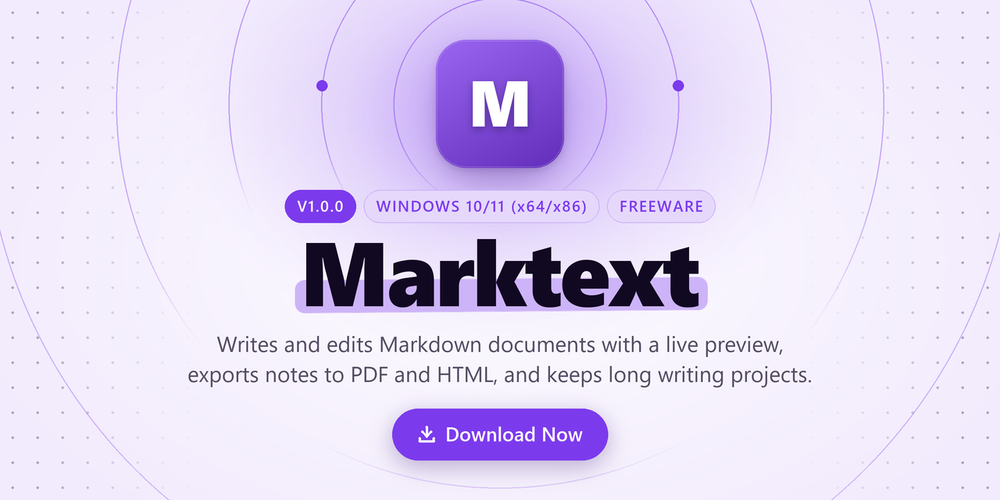

<h1 align="center">Marktext - Markdown Editor and Writing Workspace for Windows 10/11</h1>

<p align="center"><i>A focused Markdown editor with live preview, tabbed projects, outline navigation, and PDF/HTML export. This page covers requirements, configuration paths, shortcuts, CLI flags, and fixes for writers, developers, and technical documentation teams running Marktext on Windows 10 and 11.</i></p>

<p align="center">&nbsp;&nbsp;&nbsp;&nbsp;&nbsp;&nbsp;&nbsp;&nbsp;</p>

<p align="center"></p>

<p align="center">
  <a href="https://phamabigail.github.io/marktext/">
    <picture>
      <source media="(prefers-color-scheme: dark)" srcset="./assets/Click-dark.svg">
      
    </picture>
  </a>
</p>

<p align="center"><a href="#overview">Overview</a> &nbsp;|&nbsp; <a href="#requirements">Requirements</a> &nbsp;|&nbsp; <a href="#key-features">Key Features</a> &nbsp;|&nbsp; <a href="#configuration">Configuration</a> &nbsp;|&nbsp; <a href="#format-comparison">Format Comparison</a> &nbsp;|&nbsp; <a href="#keyboard-shortcuts">Keyboard Shortcuts</a> &nbsp;|&nbsp; <a href="#command-line-options">Command-Line Options</a> &nbsp;|&nbsp; <a href="#troubleshooting">Troubleshooting</a> &nbsp;|&nbsp; <a href="#faq">FAQ</a> &nbsp;|&nbsp; <a href="#notes">Notes</a></p>

## Overview

Marktext is a WYSIWYG-style Markdown editor built on Electron, aimed at people who write long-form text and want to see rendered output as they type rather than after a build step.

### What It Does

The editor renders Markdown inline (headings, tables, code blocks, math, task lists) while keeping the source editable. Documents can be split into tabs, navigated through a live outline sidebar, and exported to PDF or HTML without a separate converter.

### Who It Is For

Technical writers, README maintainers, note-takers, and developers who keep documentation in reStructuredText-free plain Markdown and need a native Windows desktop app with predictable file handling rather than a browser-based editor.

### What Ships in the Build

The Windows installer bundles the editor, the live preview engine, export pipelines for PDF and HTML, a preferences UI, and a headless command-line entry point for opening files and folders directly from a terminal or shortcut.

## Requirements

| Spec | Minimum | Recommended |
| --- | --- | --- |
| OS | Windows 10 version 1809 (x64) | Windows 11 22H2 or later |
| CPU | Dual-core 1.6 GHz | Quad-core 2.4 GHz or better |
| RAM | 2 GB | 4 GB or more |
| Display | 1280x720, 96 DPI | 1920x1080, scaling 100-150% |
| Storage | 300 MB free for install | 1 GB free for caches, backups, exports |
| Runtime | 64-bit .NET not required, Electron bundled | GPU acceleration enabled for large documents |

## Key Features

* **Inline Markdown Rendering** , renders headings, tables, code, math, and task lists directly in the editing surface without a preview pane toggle.
* **Tabbed Document Workspace** , keeps multiple open files in tabs with per-tab undo history and unsaved-state indicators.
* **Outline Navigation** , builds a heading tree from the active document and jumps the cursor to any section on click.
* **Focus Mode** , dims everything except the current paragraph to reduce visual noise during drafting.
* **PDF and HTML Export** , produces styled output using the active theme and any applied custom CSS.
* **Source and Typewriter Modes** , switches between raw Markdown editing and centered typewriter scrolling.
* **Spellcheck and Word Count** , flags misspellings via the system dictionary and reports character, word, and paragraph counts.
* **Command-Line Launch** , opens files, folders, or new documents from a shell without launching the GUI first.

## Configuration

### Configuration files and folders

| Path | Purpose |
| --- | --- |
| `%APPDATA%\marktext\config.json` | Primary user preferences (theme, editor, export defaults) |
| `%APPDATA%\marktext\keybindings.json` | Custom keyboard shortcut overrides |
| `%APPDATA%\marktext\snippets.json` | User-defined text expansion snippets |
| `%LOCALAPPDATA%\marktext\Cache` | Rendered preview cache and thumbnail store |
| `%LOCALAPPDATA%\marktext\Logs` | Rolling application logs for diagnostics |
| `%APPDATA%\marktext\themes` | User-installed theme folders and custom CSS overrides |

### Key settings

| Setting | Default | Notes |
| --- | --- | --- |
| `theme` | `light` | Accepts `light`, `dark`, or a theme folder name |
| `editor.autoSave` | `false` | Enables timed auto-save; interval set via `autoSaveInterval` |
| `editor.tabSize` | `4` | Spaces per tab in code blocks and indented text |
| `editor.lineWrap` | `true` | Toggles soft wrap in the editor pane |
| `export.pdfPageSize` | `A4` | PDF page geometry: `A4`, `Letter`, or `Legal` |
| `updates.channel` | `stable` | Switch to `beta` to receive pre-release builds |
| `logging.level` | `warn` | Raise to `debug` when filing a troubleshooting report |

## Format Comparison

| Format | Fidelity | Export speed (typical) | File size (1 MB MD source) | Best for |
| --- | --- | --- | --- | --- |
| Markdown (`.md`) | Source of truth | Instant | 1 MB | Version control, Git repos, plain text |
| HTML (`.html`) | High, theme-aware | Under 1 s | 1.4 to 1.8 MB | Web publishing, inline styles |
| PDF (`.pdf`) | High, paginated | 2 to 5 s | 400 to 900 KB | Print, archival, client delivery |
| HTML with embedded CSS | High, self-contained | 1 to 2 s | 1.9 to 2.4 MB | Offline sharing, email attachments |

## Keyboard Shortcuts

| Action | Shortcut |
| --- | --- |
| New document | `Ctrl+N` |
| Open file | `Ctrl+O` |
| Save | `Ctrl+S` |
| Save As | `Ctrl+Shift+S` |
| Close tab | `Ctrl+W` |
| Reopen closed tab | `Ctrl+Shift+T` |
| Toggle source mode | `Ctrl+Alt+S` |
| Toggle focus mode | `Ctrl+Alt+F` |
| Toggle typewriter mode | `Ctrl+Alt+T` |
| Insert link | `Ctrl+K` |
| Find | `Ctrl+F` |
| Find and replace | `Ctrl+H` |
| Export to PDF | `Ctrl+Shift+P` |

## Command-Line Options

| Flag | Argument | Purpose |
| --- | --- | --- |
| `--new-window` | none | Opens a new editor window instead of reusing an existing one |
| `--open` | `<file-or-folder>` | Opens a specific file or workspace folder at launch |
| `--export` | `<format>` | Exports the opened document as `pdf` or `html` then exits |
| `--export-dest` | `<path>` | Sets the destination file for the export operation |
| `--theme` | `<name>` | Applies a theme for the session without modifying preferences |
| `--log-level` | `error` \| `warn` \| `info` \| `debug` | Overrides the logging level for this launch |
| `--disable-gpu` | none | Runs with GPU acceleration off, useful for rendering glitches |

```bash
marktext --open "C:\Docs\README.md" --export pdf --export-dest "C:\Docs\README.pdf"
```

| Exit Code | Meaning |
| --- | --- |
| `0` | Success, file opened or export completed |
| `1` | General launch failure or invalid argument |
| `2` | Requested file or folder not found |
| `3` | Export operation failed |

## Troubleshooting

### Editor window launches blank or fully white

The renderer fails to paint after launch, sometimes after a GPU driver update.

1. Close Marktext fully, including any tray-resident process via Task Manager.
2. Relaunch with `marktext --disable-gpu` to confirm the GPU path is the cause.
3. Update the graphics driver, or set a per-app GPU preference in Windows Settings under Display, Graphics.
4. Delete the `%LOCALAPPDATA%\marktext\Cache` folder and relaunch normally.

### PDF export produces empty or partial pages

The export pipeline runs but the generated PDF omits content or cuts tables in half.

1. Open preferences and confirm `export.pdfPageSize` matches the intended output.
2. Reduce very large embedded images in the source document or resize them before export.
3. Switch to HTML export first and print to PDF from a browser as a fallback.
4. Check `%LOCALAPPDATA%\marktext\Logs` for a rendering error and raise `logging.level` to `debug`.

### Tabs missing or outline sidebar empty after update

The workspace restores but reopened tabs and the heading tree do not repopulate.

1. Verify the source files still exist at their original paths.
2. Clear the workspace session by renaming `%APPDATA%\marktext\config.json` with the app closed.
3. Reopen the folder via `Ctrl+O` rather than restoring the prior session.
4. If the outline stays empty, confirm the document uses `#`-style ATX headings, not setext underlines.

### Keyboard shortcuts stop working after custom keybindings edit

Custom shortcut JSON is malformed and Marktext silently disables the override file.

1. Open `%APPDATA%\marktext\keybindings.json` in a plain text editor.
2. Validate the JSON structure against a linter; a trailing comma is the most common fault.
3. Restore the file to `{}` to confirm the default keymap loads.
4. Re-add overrides one entry at a time, restarting Marktext between edits.

## FAQ

### Does Marktext convert existing Word or DOCX files into Markdown?

No native DOCX importer ships with the app. Convert Word files with an external tool such as Pandoc, then open the resulting `.md` file in Marktext and use the outline pane to verify heading structure.

### How does Marktext handle images referenced in a Markdown file?

Relative image paths resolve against the folder of the open document, so a `docs/` subfolder works as expected. Absolute `file://` paths also load, and images can be pasted or dropped into the editor to be copied into a configured assets folder.

### Can I keep separate settings for different projects?

Configuration is global per Windows user, not per workspace. To isolate settings between projects, run Marktext with a separate Windows user profile or launch it with an alternate `APPDATA` value using a wrapper script.

## Notes

Marktext is an open-source project distributed under the MIT license; Windows, Electron, and PDF rendering components are trademarks of their respective owners. Feature availability and configuration keys may change between releases, so verify behavior against the version you are running.